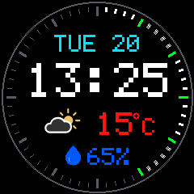
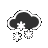

# ESP32 Network Clock

A native ESP-IDF clock for an ESP32 with a 240x240 GC9A01 round display. It
shows the local date and 24-hour time, along with current temperature,
humidity, and weather conditions. Time is synchronized over NTP, while weather
is fetched from OpenWeatherMap over Wi-Fi and HTTPS. The default location and
timezone are set for Budaors, Hungary. Configure Wi-Fi credentials, the
OpenWeatherMap API key, and weather location coordinates locally through
`menuconfig`.

## Preview



### Weather icons

| Condition | Day | Night |
| --- | --- | --- |
| Broken clouds |  | — |
| Clear sky |  |  |
| Few clouds |  |  |
| Mist |  |  |
| Rain |  |  |
| Scattered clouds |  | — |
| Shower rain |  |  |
| Snow |  |  |
| Thunderstorm |  |  |
| Sunrise / sunset |  |  |

## Hardware

Display pins depend on `ENABLE_SERIAL_LOG` in `main/main.c` (default `0`):

| Display signal | Logging off (default) | Logging on |
| --- | ---: | ---: |
| SCK / SCL | 16 | 18 |
| MOSI / SDA | 17 | 23 |
| DC | 21 | 26 |
| CS | 22 | 5 |
| RST | 3 | 33 |

The display CS is driven as a GPIO while SPI is configured with hardware chip
select disabled. With logging off, GPIO3 (the UART0 RX pin) is used for display
reset to match the seven-pin wiring. By default the ESP-IDF UART console and
bootloader logs are disabled, so UART serial input and log output are
unavailable. The ROM may still print its initial boot message before ESP-IDF
starts.

Power the display's VCC from the board's 5 V pin only if that is supported by
the display module. The ESP32 GPIO signals are 3.3 V; a 5 V VCC rating does not
mean the display's signal inputs are 5 V tolerant. No backlight pin was present
in the Arduino project.

## Configure, build, and flash

The board has 4 MiB of flash (verified with `esptool flash-id`). The project
uses a custom single-application layout in `partitions.csv`: the existing
NVS and PHY partitions keep their offsets, and the factory application spans
`0x10000` through `0x3fffff` (4032 KiB). This layout does not provide OTA slots.
The flash size and partition layout are set in `sdkconfig.defaults`; for an
existing configuration, select **Serial flasher config → Flash size → 4 MB**
and **Partition Table → Partition Table → Custom partition table CSV**, with
`partitions.csv` as the filename.

1. Install ESP-IDF 5.5 and its required tools. Open the **ESP-IDF 5.5 Command
   Prompt** (or another shell where ESP-IDF has been exported).
2. Change to this project directory:

   ```bat
   cd /d path\to\net-clock
   ```

3. Select the ESP32 target and configure the project:

   ```bat
   idf.py set-target esp32
   idf.py menuconfig
   ```

   In `menuconfig`, set **Network clock → Wi-Fi SSID**, **Wi-Fi password**,
   **OpenWeatherMap API key**, and, if needed, **Weather location latitude**
   and **Weather location longitude** in decimal degrees. The default
   coordinates are for Budaors; latitude must be between -90 and 90, and
   longitude between -180 and 180. The NTP server defaults to `pool.ntp.org`.
   **POSIX timezone** defaults to Central European time with daylight-saving
   rules, matching Budaors. Changing the weather coordinates does not change
   the timezone automatically; set it separately for the chosen location.
   Weather is reported in metric units.
4. Build the firmware:

   ```bat
   idf.py build
   ```

5. Connect the board over USB, identify its serial port in Windows Device
   Manager, then flash it (replace `COM7` with the board's port):

   ```bat
   idf.py -p COM7 flash
   ```

   If the board does not enter download mode automatically, hold its **BOOT**
   button while starting the flash, then release it when flashing begins.
   After changing the partition layout, use the full `flash` command above,
   not `app-flash`, to write the bootloader and partition table as well.

The clock waits for Wi-Fi and NTP time before drawing its first reading.
OpenWeatherMap is queried over HTTPS using ESP-IDF's certificate bundle. The
weather data refreshes every ten minutes; after a failed request, the last
successful reading remains visible and another attempt is made after one
minute. The dial's minute marks also visualize seconds elapsed in the current
minute: at `:00`, all marks are green or white; at other seconds, elapsed
marks turn white while every fifth elapsed mark turns green, and the 12
o'clock mark stays gray. Idle marks are darker gray. White elapsed marks are
three pixels thick; idle marks retain their original sizes. The display also
blinks the time colon between white and the same dark gray every half second.
It uses a larger date and a raised time/weather layout with a teardrop humidity
indicator. For clear sky or few clouds
(OpenWeatherMap icon codes `01` and `02`), the weather icon is replaced by the
sunrise or sunset icon from 30 minutes before through 30 minutes after the
event. Event times come from the API's `sys.sunrise` and `sys.sunset` Unix
timestamps; missing event times leave the normal icon visible. Absolute
timestamps keep the window correct across timezone and daylight-saving
changes.

Weather symbols are RGB565 display assets based on the OpenWeatherMap-compatible
day/night SVGs archived in `docs/orig/`, including sunrise and sunset.
To export the exact packed icons used by the firmware as transparent PNGs in
`docs/`, run `python tools\render_weather_icons.py`. The renderer reads
`main/weather_icons.h` and uses only the Python standard library.
To render the sample 240x240 screen to `docs/screen_shot.png`, run
`python tools\render_screen_shot.py`. Edit the parameters in the script's
`main()` call to change the date, time, seconds, temperature, weather icon, or
humidity.

`menuconfig` stores credentials in the local `sdkconfig` file. It is ignored
by Git; do not commit it because Wi-Fi credentials and the weather API key are
included in the firmware image.

## Serial logging (debugging)

Logging is off by default. To enable it:

1. In `main/main.c`, set `#define ENABLE_SERIAL_LOG 1`. This enables the
   `ESP_LOGx` calls (display commands, SPI results, Wi-Fi, NTP, per-frame
   messages) and switches the display to the logging-on pins above, so GPIO3
   stays free for the console. Rewire the display accordingly.
2. In `sdkconfig.defaults`, replace the two lines with:

   ```
   CONFIG_ESP_CONSOLE_UART_DEFAULT=y
   CONFIG_BOOTLOADER_LOG_LEVEL_INFO=y
   ```

   An existing `sdkconfig` overrides the defaults file, so delete `sdkconfig`
   (and re-enter the Wi-Fi and OpenWeatherMap settings in `menuconfig`) or
   change the console and bootloader log options in `menuconfig` instead.
3. Build, flash, and watch the output:

   ```bat
   idf.py -p COM7 build flash monitor
   ```

To disable logging again, set the flag to `0`, restore
`CONFIG_ESP_CONSOLE_NONE=y` and `CONFIG_BOOTLOADER_LOG_LEVEL_NONE=y`, and
rewire the display to the default pins. With the flag at `0`, the log macros
compile to nothing.

## Notes

- The SPI clock is 40 MHz with `SPI_DEVICE_NO_DUMMY` (the display is
  write-only). If the picture shows noise or lines, lower `clock_speed_hz` in
  `display_initialize`; the GC9A01 init sequence is in the same function.
